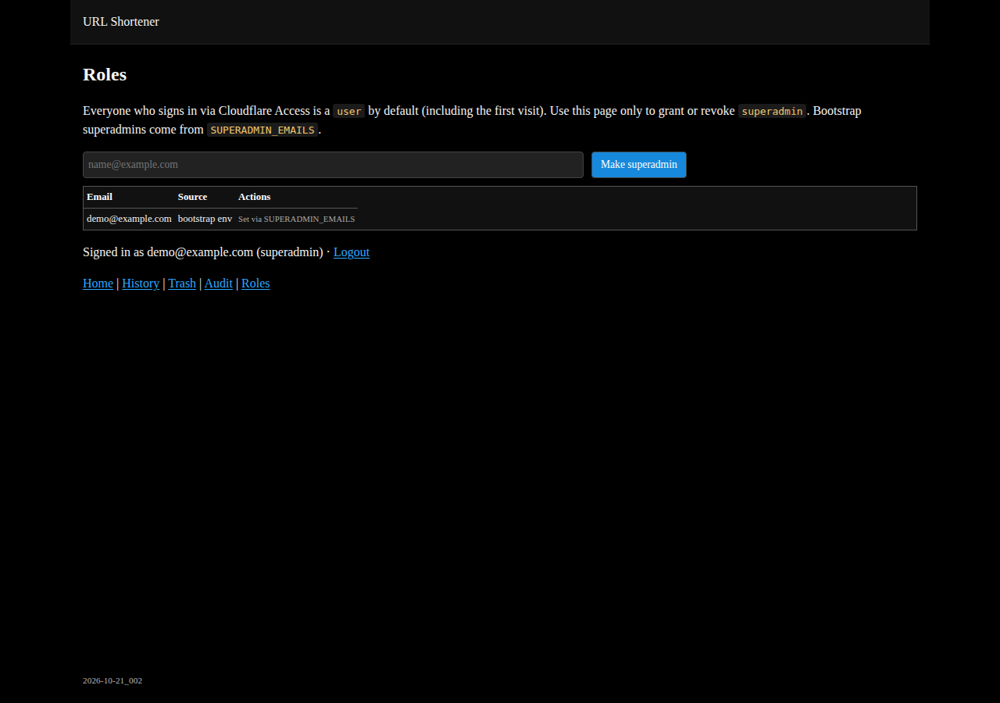

# URL Shortener

Hono-based URL shortener for Cloudflare Workers and KV. Originally based on
[Yusuke Wada’s tutorial](https://github.com/yusukebe/url-shortener); this fork
adds destination checks, soft-delete, audit logging, Access-aware roles, and
stricter security defaults.

The administration UI is intended to sit behind **Cloudflare Access** (SSO).
Short links (`/<six-character-key>`) stay public.

## Features

- Six-character short URLs stored in Cloudflare KV
- Destination validation before link creation (SSRF-safe)
- Local QR code generation (no third-party QR APIs)
- Searchable History, Trash (soft delete), and Audit log
- Creator / superadmin authorization for delete, restore, and purge
- Rebuild orphan KV keys into History
- CSRF protection, CSP nonces (no `unsafe-inline`), rate limits
- Optional webhook alerts for unhandled errors
- Deploy version stamp on admin pages (`BUILD_VERSION` in `src/version.ts`)

## Screenshots

Local preview captures with a placeholder **LOGO** badge and public sample
URLs (`example.com`, `short.example`). Replace with your own branding if you
fork.

### Create


### History


### Trash


### Missing short link


### Audit log


### Roles



## Stack

| Component | Purpose |
| --- | --- |
| Hono | Routing and server-rendered JSX |
| Zod | Input validation |
| Vite | Development and production builds |
| Cloudflare Workers | Application runtime |
| Cloudflare KV | Links, History, Trash, roles, audit, rate limits |
| Cloudflare Access | Authentication for `/admin/*` |

## Routes

| Route | Access | Purpose |
| --- | --- | --- |
| `/admin/` | Authenticated | Create a short link |
| `/admin/history` | Authenticated | Review and soft-delete links |
| `/admin/trash` | Authenticated | Restore or permanently purge |
| `/admin/audit` | Authenticated | Review events |
| `/admin/roles` | Superadmin | Grant / revoke superadmin |
| `/<six-character-key>` | Public | Redirect to the destination |

## Local development

Requirements: Node.js 22.12+ and npm.

```bash
git clone https://github.com/DPOGH/url-shortener.git
cd url-shortener
npm ci
npm run dev
```

Worker-compatible preview with local KV:

```bash
npm run build
npm run preview
```

Copy `.dev.vars.example` to `.dev.vars` for local runtime vars (gitignored).

Before submitting changes:

```bash
npm ci
npm test
npm run build
npm audit --audit-level=low
npx wrangler deploy --dry-run
```

## Install on Cloudflare Workers

### 1. Create a KV namespace

```bash
npx wrangler kv namespace create URL_SHORTENER
```

Put the returned **id** into `wrangler.toml`:

```toml
[[kv_namespaces]]
binding = "KV"
id = "<your-kv-namespace-id>"
```

### 2. Create / connect the Worker

**Option A — Workers Builds (GitHub, recommended)**

1. Cloudflare Dashboard → **Workers & Pages** → **Create** → connect this GitHub repository.
2. Build command: `npm run build`
3. Deploy with Wrangler / Workers Builds using this `wrangler.toml` (`main = "dist/_worker.js"`).
4. Production branch: `main`.
5. After the first deploy, attach a custom domain if you want (e.g. `short.example.com`).

**Option B — CLI**

```bash
npm ci
npm run build
npx wrangler deploy
```

### 3. Cloudflare Access (admin only)

1. Zero Trust → **Access** → **Applications** → protect your hostname.
2. Policy: allow your org emails / IdP (e.g. Microsoft Entra).
3. Protect `/admin*`; keep short-link paths public (bypass or separate app).
4. Until Access is scoped **only** to the custom hostname, keep `workers_dev = true` in `wrangler.toml` so the Access login callback can complete. Then set `workers_dev = false` if you no longer need `*.workers.dev`.

### 4. Bootstrap superadmin (`SUPERADMIN_EMAILS`) — important

Everyone who signs in via Access is a **`user` by default** (including the first
visit). You do **not** assign the `user` role.

The first **superadmin** must be bootstrapped with a **Worker runtime variable**:

1. Cloudflare Dashboard → **Workers & Pages** → your Worker (`url-shortener`).
2. **Settings** → **Variables and Secrets**.
3. Under **Variables** for the Worker runtime (**not** “Build variables”, **not**
   the section that lists Deploy Hooks):
   - Type: **Variable** (plaintext)
   - Name: `SUPERADMIN_EMAILS`
   - Value: comma-separated emails, e.g. `admin@example.com,ops@example.com`
4. **Save** / Deploy if prompted.

Notes:

- Build variables do **not** reach `c.env` in the Worker. Only runtime Variables
  (or `[vars]` in `wrangler.toml`) do.
- Prefer the dashboard over committing real emails in git.
- After bootstrap, superadmins manage others at `/admin/roles` (grant/revoke
  `superadmin` only). The last effective superadmin cannot be removed.
- Optional secret: `ALERT_WEBHOOK_URL` for Teams/Slack error webhooks
  (`wrangler secret put ALERT_WEBHOOK_URL` or dashboard Secret).

### 5. Verify

- Open `/admin/` → Access login → create a short link.
- As a bootstrap email you should see **(superadmin)** and **Roles**.
- Open a short URL without auth; it should redirect to the destination.

## Roles (user / superadmin)

| Role | Who | Capabilities |
| --- | --- | --- |
| `user` | Default for every Access login | Create links; manage only own links |
| `superadmin` | `SUPERADMIN_EMAILS` and/or `/admin/roles` grants | Manage any link; assign superadmins |

Only superadmin grants are stored in KV (`__roles__`).

## Storage

| KV key | Content |
| --- | --- |
| `<six-character-key>` | Destination URL |
| `__history__` | Latest 5000 History records |
| `__trash__` | Latest 1000 soft-deleted links |
| `__roles__` | Email → `superadmin` grants |
| `__audit__` | Latest 1000 audit events |
| `__rate__:*` | Temporary rate-limit counters |

## Security

- Cloudflare Access for `/admin/*`
- HTTP(S) destinations only; DoH-based SSRF checks; private IP blocked
- CSRF (Origin / Fetch Metadata), CSP nonces, HSTS, and related headers
- Rate limits on create / check / delete-style admin actions
- No third-party CDNs for UI or QR

Do not commit API tokens, Access credentials, or `.dev.vars`. Prefer reporting
security issues privately to the repository maintainers.

## License

Licensed under the [MIT License](LICENSE).

Originally based on Yusuke Wada's
[Hono URL Shortener](https://github.com/yusukebe/url-shortener).
