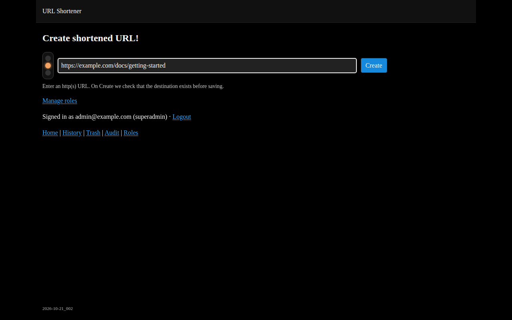
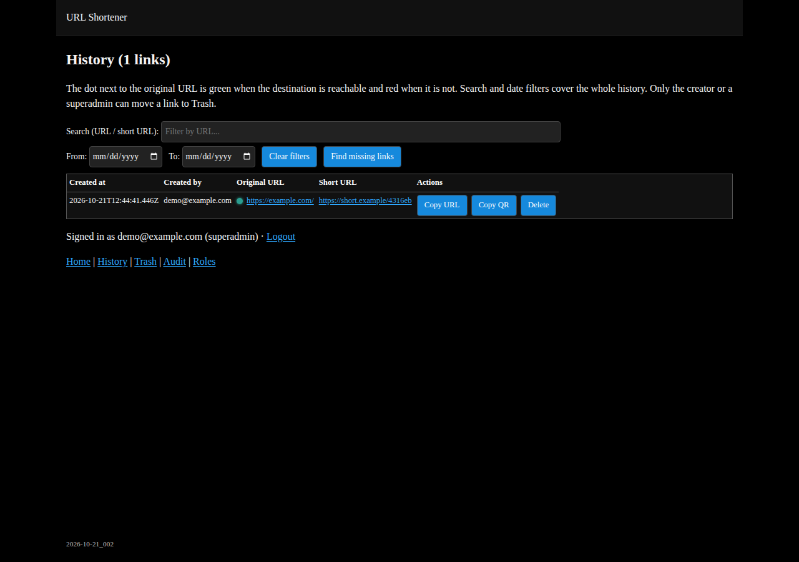
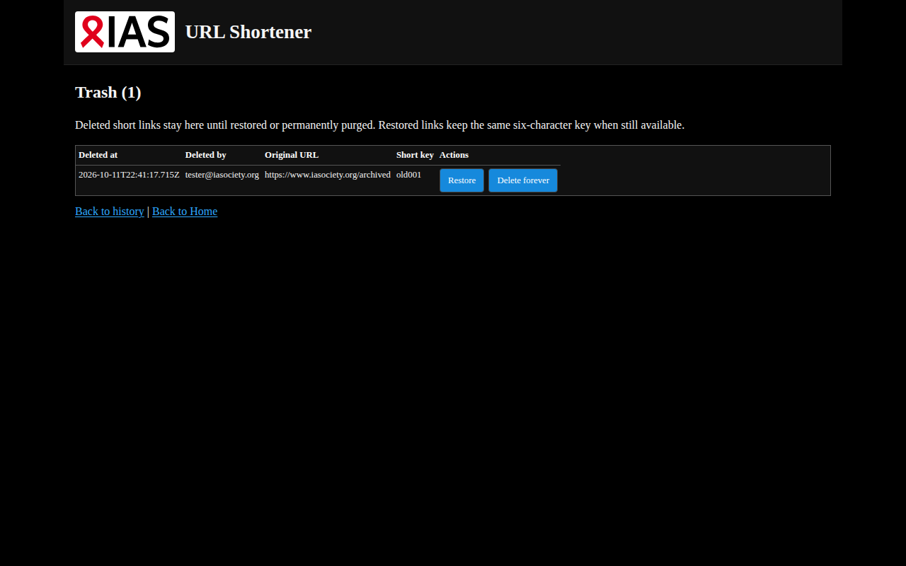
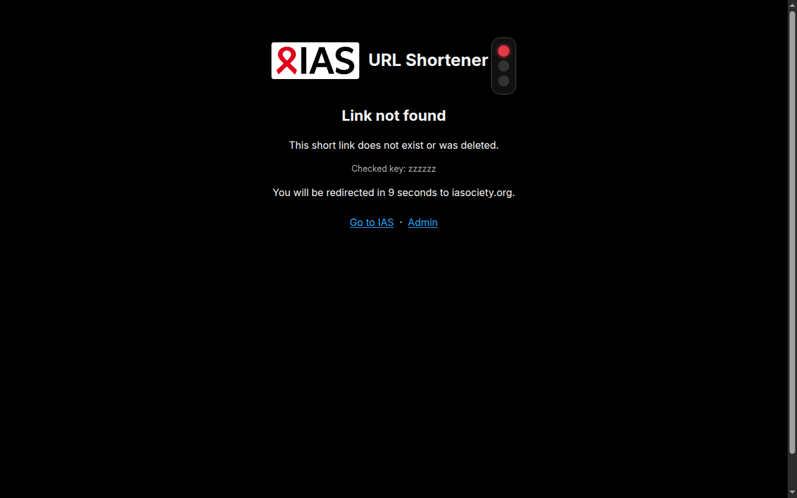
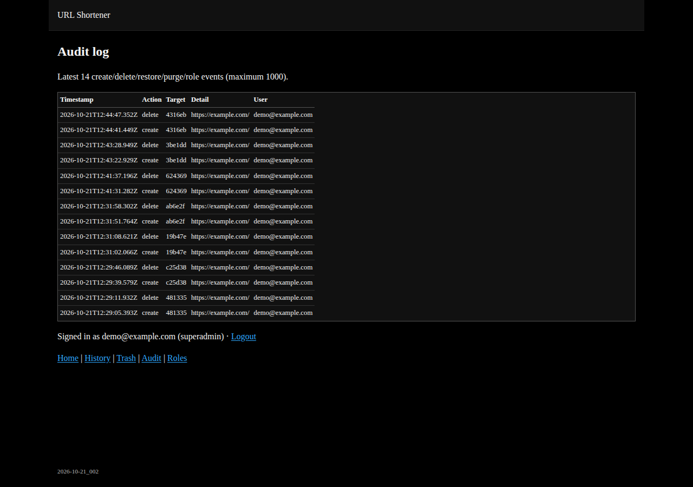

# IAS URL Shortener

Internal URL-shortening service for IAS, deployed on Cloudflare at
[toias.link](https://toias.link).

The administration area is protected by Cloudflare Access and Microsoft Entra
ID. Short URLs remain public so recipients can open them without signing in.

## Features

- Six-character short URLs stored in Cloudflare KV
- Destination validation before link creation
- SSRF-safe reachability checks
- Local QR code generation with no third-party service
- Searchable History with destination status indicators
- Soft delete with Trash restore / permanent purge
- Delete/restore/purge limited to the creator or configured superadmins
- “Find missing links” rebuilds active KV keys missing from History
- Create/delete/restore/purge audit log with authenticated user identity
- Optional webhook alerts for unhandled errors
- Strict security headers, CSRF protection, and rate limiting
- No automatic expiration for links or History
- Copy URL and QR actions
- Weekly Dependabot update checks

## Screenshots

Captured from the running application (local Worker preview). You can replace
these with production captures from `toias.link` if preferred.

### Create



### History



### Trash



### Missing short link



### Audit log



## Stack

| Component | Purpose |
| --- | --- |
| Hono | Routing and server-rendered JSX |
| Zod | Input validation |
| Vite | Development and production builds |
| Cloudflare Workers | Application runtime |
| Cloudflare KV | Links, History, audit events, and rate limits |
| Cloudflare Access | Entra ID authentication for `/admin/*` |

The main application is in `src/index.tsx`, the shared renderer in
`src/renderer.tsx`, and local styles in `src/style.css`.

## Routes

| Route | Access | Purpose |
| --- | --- | --- |
| `/admin/` | Authenticated | Create a short link |
| `/admin/history` | Authenticated | Review and soft-delete links |
| `/admin/trash` | Authenticated | Restore or permanently purge deleted links |
| `/admin/audit` | Authenticated | Review create/delete/restore/purge events |
| `/<six-character-key>` | Public | Redirect to the destination |

Missing links display an error page and redirect to
`https://www.iasociety.org` after ten seconds.

Cloudflare Access policies are managed outside this repository. The intended
policy is authenticated access to `/admin/*` and public bypass for short-link
routes.

## Local development

Requirements:

- Node.js 22.12 or newer
- npm

Install and start:

```bash
git clone https://github.com/DPOGH/url-shortener.git
cd url-shortener
npm ci
npm run dev
```

For a Worker-compatible preview with local KV:

```bash
npm run build
npm run preview
```

Local KV data is separate from production data.

Before submitting changes:

```bash
npm ci
npm test
npm run build
npm audit --audit-level=low
npx wrangler deploy --dry-run
```

Automated tests cover SSRF host/IP filtering, CSRF protection, create/delete
flows, redirects, favicon/404 pages, CSP headers, and admin rate limits.

## Configuration

Cloudflare configuration is stored in `wrangler.toml`. The application requires
a KV namespace bound as `KV`.

```toml
workers_dev = true   # Access login callback — see below
preview_urls = false
```

`preview_urls` stays disabled. `workers_dev` stays **enabled** because
Cloudflare Access completes login on
`url-shortener.it-5e9.workers.dev`. With `workers_dev = false`, that callback
returned 404 and blocked admin access.

Admin routes on `toias.link` and that `workers.dev` hostname are reachable
only through Cloudflare Access. Short links stay public.

Never commit API tokens, Access credentials, or `.dev.vars`.

## Deployment

Production is connected to GitHub through Cloudflare Workers Builds:

1. Open a pull request into `main`.
2. Wait for `Workers Builds: url-shortener` to pass.
3. Review and merge the pull request.
4. Cloudflare automatically builds and deploys `main`.
5. Verify the result on `toias.link`.

An authenticated operator can deploy manually with:

```bash
npm run deploy
```

The GitHub-connected workflow is preferred.

## Storage

| KV key | Content |
| --- | --- |
| `<six-character-key>` | Destination URL |
| `__history__` | Latest 5000 History records (page shows 100 at a time) |
| `__trash__` | Latest 1000 soft-deleted links |
| `__roles__` | Email → `superadmin` grants only (everyone else is user) |
| `__audit__` | Latest 1000 create/delete/restore/purge/role events |
| `__rate__:*` | Temporary rate-limit counters |

History and audit lists have count limits but no time-based expiration.
Cloudflare KV is eventually consistent.

## Security

- Cloudflare Access protects all administration routes.
- Only HTTP and HTTPS destinations are accepted.
- DNS and every redirect target are checked before probing.
- Private, loopback, link-local, reserved, and non-public IPs are blocked.
- Destination checks have a five-second timeout and five-redirect limit.
- Create, check, and delete actions are rate limited through KV.
- Unsafe requests require same-site Origin and Fetch Metadata headers.
- CSP uses per-request nonces without `unsafe-inline`.
- HSTS, anti-clickjacking, MIME, referrer, permission, and cross-origin headers
  are enabled.
- UI assets and QR generation do not depend on third-party CDNs.
- Preview URLs stay disabled. `workers_dev` stays enabled for the Access
  login callback. Admin hostnames are reachable only through Cloudflare Access.

Do not disclose sensitive URLs or exploit details in public issues. Report
security concerns through the IAS internal IT/security channel.

## Maintenance

Dependabot checks npm dependencies weekly, requests review from `DPOGH`, and
does not merge updates automatically.

Use:

- `/admin/history` to inspect destinations and move links to Trash;
- `/admin/trash` to restore or permanently purge deleted links;
- `/admin/audit` to identify who created, deleted, restored, or purged a link;
- Cloudflare Worker logs for runtime errors and structured audit events.

### Roles (user / superadmin)

- Everyone who signs in via Cloudflare Access is a `user` by default, including
  the first visit. No role assignment is required.
- Users can create links and manage only their own.
- Superadmins can manage any link and open `/admin/roles` to grant or revoke
  `superadmin` for other IAS emails. The `user` role is never assigned manually.
- Only superadmin grants are stored in KV (`__roles__`).
- Bootstrap superadmins via runtime Worker var `SUPERADMIN_EMAILS` (set in
  `wrangler.toml` `[vars]` or Worker **Settings → Variables**, not Build
  variables). Example: `dario.porru@iasociety.org`.
- Admin pages show **Signed in as …** and **Logout**
  (`/cdn-cgi/access/logout`) to clear the Cloudflare Access session cookie.
- The last effective superadmin cannot be removed.

### Find missing links

On `/admin/history`, **Find missing links** scans KV for active six-character
keys that are not in History (and not in Trash) and appends them as
`legacy / unknown`. Creation date/owner cannot be recovered for those entries.

### Error alerts

Unhandled Worker errors are always written to Cloudflare logs. To also receive a
Teams or Slack message, set the secret `ALERT_WEBHOOK_URL` to an incoming
webhook URL in the Cloudflare dashboard (or with
`wrangler secret put ALERT_WEBHOOK_URL`).

Also enable Cloudflare Notifications for Worker error spikes if you want
dashboard/email alerts without a webhook.

## License

Licensed under the [MIT License](LICENSE).

Originally based on Yusuke Wada's
[Hono URL Shortener tutorial](https://github.com/yusukebe/url-shortener).
